**# RouteCraft — User Manual**


**\*\*Multi-Depot Vehicle Routing Studio\*\***  

**\*\*Team:\*\*** AlgoSmiths  

**\*\*Project:\*\*** CSLR31 — Data Structures Laboratory


This manual explains how to start RouteCraft, prepare a depot-and-customer network, configure the fleet, generate routes, inspect the results, simulate dispatch, and export a route plan.


\---


**## 1. What RouteCraft does**


RouteCraft is a desktop application for planning delivery routes from multiple depots. You provide depot locations, customer locations and demands, vehicle capacity, and depot-wise fleet availability. The application computes routes, assigns customers to depots, and reports the use of dedicated, ad-hoc and virtual vehicles.


The application has three main parts:


\- **\*\*Java Swing interface:\*\*** accepts inputs and displays the map, routes and summaries.

\- **\*\*Java orchestration and JNI:\*\*** coordinates the optimization workflow and communicates with the native engine.

\- **\*\*C++17 routing engine:\*\*** performs road-network processing and route optimization.


**## 2. System requirements**


For the supplied Windows launcher (\`run.bat\`), install:


1\. **\*\*JDK 17 or newer.\*\*** The \`javac\` and \`java\` commands must be available on \`PATH\`.

2\. **\*\*64-bit C++17 compiler.\*\*** A 64-bit MinGW-w64 \`g++\` toolchain is supported. The launcher checks \`C:\msys64\ucrt64\bin\g++.exe\` first, then searches \`PATH\`.

3\. **\*\*\`JAVA_HOME\` environment variable\*\*** pointing to the JDK installation directory (not the \`bin\` directory).

4\. **\*\*Internet connection\*\*** if you want the application to retrieve background map tiles after loading an OSM road extract.


The Java and C++ toolchains must both be 64-bit so that the native library can be loaded by the JVM.


**## 3. Start RouteCraft on Windows**


1\. Extract the complete project ZIP to a folder where you have permission to create files.

2\. Confirm that the project root contains \`run.bat\`, \`Makefile\`, \`Source\`, \`include\` and \`map.osm\`.

3\. Install the required JDK and C++ compiler, if they are not already installed.

4\. Set \`JAVA_HOME\` to your JDK directory. For example, if the JDK is installed at \`C:\Program Files\Java\jdk-21\`, set \`JAVA_HOME\` to that directory.

5\. Open the extracted project folder in File Explorer.

6\. Double-click **\*\*\`run.bat\`\*\***. Alternatively, open Command Prompt in the project root and execute:


   ```bat

   run.bat

   ```


The launcher compiles the C++ sources into \`build\RouteCraftDsa.dll\`, compiles the Java application into \`build\`, and starts the Swing application. Keep the project folder structure intact; the launcher uses relative paths.


If the application does not start, read the error printed in the terminal before closing it. See [Troubleshooting]\(#12-troubleshooting).


**## 4. Understand the main screen**


The workspace contains the following areas:


\| Area | Purpose |

\|---|---|

\| Solver panel | Select the route-construction method, vehicle capacity and objective weights. |

\| Customer controls | Add customers using X/Y coordinates and demand. |

\| Depot network | Add, select, remove and configure depots. |

\| Customer register | View and select customers already in the scenario. |

\| Network map | Inspect the network, place customers or depots, and view computed routes. |

\| Summary cards | View total distance, fleet utilization, customers served and total demand. |

\| Route output | Inspect route details, customer reassignment and depot-wise fleet summary. |


The map legend identifies customers, depots and routes. Use **\*\*FIT MAP\*\*** to fit the network into the visible map area. The vehicle selector can be used to focus the map on a particular vehicle or on all vehicles.


**## 5. Create a delivery scenario**


A scenario needs at least one depot and one customer.


**### 5.1 Load the sample scenario**


Click **\*\*LOAD SAMPLE\*\*** to populate the workspace with a demonstration network containing two depots and multiple customers. This is the quickest way to explore the application before entering your own data.


**### 5.2 Add a customer using the side panel**


1\. In **\*\*NEW CUSTOMER\*\***, enter the customer's X and Y coordinates. The controls accept values from 0 to 100.

2\. Enter the customer's **\*\*Demand units\*\***.

3\. Click **\*\*ADD CUSTOMER\*\***.

4\. Confirm that the new customer appears in the customer register and on the map.


Each customer has a demand that must be served by a vehicle whose capacity is sufficient. A customer whose individual demand exceeds the configured vehicle capacity cannot be served by the current vehicle model.


**### 5.3 Place a customer directly on the map**


1\. Set the map mode to **\*\*Place customer\*\***.

2\. Set the demand in the **\*\*Demand units\*\*** control.

3\. Click the desired position on the map.

4\. The application adds the customer and returns the map mode to **\*\*Inspect nodes\*\***.


**### 5.4 Add a depot**


1\. Enter the depot X and Y coordinates in the **\*\*DEPOT NETWORK\*\*** section.

2\. Click **\*\*ADD DEPOT\*\***.

3\. Select the new depot in **\*\*ACTIVE DEPOTS\*\*** before configuring its fleet.


You can also select **\*\*Place depot\*\*** in the map-mode selector and click the desired map position. A newly added depot receives the application's default fleet values; review and change them using **\*\*CONFIGURE FLEET\*\***.


**### 5.5 Select, edit, duplicate or remove customers**


\- Select a customer from **\*\*CUSTOMER REGISTER\*\*** or click its marker on the map.

\- Click **\*\*EDIT SELECTED\*\*** to change its X coordinate, Y coordinate or demand.

\- Click **\*\*DUPLICATE CUSTOMER\*\*** to create a copy of the selected customer.

\- Click **\*\*REMOVE CUSTOMER\*\*** to delete the selected customer.

\- Select a depot in **\*\*ACTIVE DEPOTS\*\*** and click **\*\*REMOVE DEPOT\*\*** to remove it.


Removing a depot changes the depot network. Ensure at least one depot remains before optimizing.


**## 6. Load a real road network (optional)**


RouteCraft can import an OpenStreetMap XML extract and use its road graph for road-aware shortest-path routing.


1\. Obtain an OpenStreetMap extract in **\*\*OSM XML\*\*** format (\`.osm\` or \`.xml\`).

2\. Click **\*\*LOAD REAL MAP + OSM ROADS\*\***.

3\. Select the OSM XML file and confirm.

4\. Wait for the road-network status to update. The application reports the loaded road-node and road-link counts.

5\. If map tiles are available, they are loaded for visual context. Internet access is needed for background map tiles.

6\. Run **\*\*OPTIMIZE ROUTES\*\*** again after loading or changing the road network.


The importer expects routable highway ways and their nodes in OSM XML. A PBF file is not accepted directly; convert it to OSM XML before importing. If no usable road nodes, ways or highway edges are found, the application reports an import error.


**\*\*Without an OSM road network:\*\*** the application can still display and optimize the scenario using its coordinate/map representation. In that mode, distance is displayed in **\*\*map units\*\***, not kilometres. With an OSM road network loaded, road distance is displayed in kilometres.


**## 7. Configure the solver and fleet**


**### 7.1 Choose the route-construction method**


In **\*\*SOLVER\*\***, select one of the following:


\- **\*\*Clarke–Wright savings + 2-opt:\*\*** constructs routes by merging customer routes based on savings, then applies 2-opt route improvement.

\- **\*\*Nearest neighbor + 2-opt:\*\*** constructs routes by repeatedly selecting a nearby next customer, then applies 2-opt route improvement.


Both options use the same vehicle-capacity constraint. These are heuristic methods; they do not guarantee a globally optimal solution.


**### 7.2 Set vehicle capacity**


Set **\*\*Capacity / vehicle\*\*** to the maximum demand units one vehicle can carry. This capacity is applied to the vehicle model used by the optimizer. Check that every individual customer demand is no greater than this value.


**### 7.3 Set objective weights**


The three sliders control the relative importance of:


\- **\*\*Distance\*\*** — route distance.

\- **\*\*Travel time\*\*** — estimated route travel time.

\- **\*\*Operating cost\*\*** — estimated route operating cost.


The application normalizes the selected weights before passing them to the optimizer. Increasing a slider gives that objective more influence relative to the other two. If all three sliders are set to zero, the application falls back to distance-only weighting.


**### 7.4 Configure fleet separately for each depot**


Fleet availability is configured per depot. Vehicles are not transferred between depots.


1\. Select a depot from **\*\*ACTIVE DEPOTS\*\***.

2\. Click **\*\*CONFIGURE FLEET\*\***.

3\. Enter the number of **\*\*Dedicated vehicles\*\*** available at that depot.

4\. Enter the **\*\*Maximum local ad-hoc vehicles\*\*** that may be activated at that depot.

5\. Confirm the dialog.

6\. Repeat for every depot.


The fleet categories mean:


\| Category | Meaning | Can be dispatched? |

\|---|---|---|

\| Dedicated | Regular vehicles assigned to their home depot. | Yes |

\| Ad-hoc | Additional local vehicles activated when the dedicated fleet is insufficient. | Yes |

\| Virtual | Planning-only indication of remaining vehicle shortage. It is not a physical vehicle. | **\*\*No\*\*** |


The optimizer may reassign customers between depots, but vehicles remain at their configured home depots. Routes are associated with a depot and return to that depot.


**## 8. Optimize routes**


Before optimization, check that:


\- At least one depot exists.

\- At least one customer exists.

\- Vehicle capacity is appropriate for customer demands.

\- Each depot has the intended dedicated and maximum ad-hoc fleet counts.

\- The intended route-construction algorithm and objective weights are selected.

\- The OSM road network is loaded if road-aware routing is required.


Then:


1\. Click **\*\*OPTIMIZE ROUTES\*\*** in the solver panel or above the map.

2\. Wait for the optimization to complete.

3\. Review the routes drawn on the map and the route output panel.

4\. Check the summary cards and the **\*\*DEPOT FLEET SUMMARY\*\***.

5\. If customers remain on virtual routes, adjust fleet availability or the customer/depot scenario and optimize again.


**### 8.1 What the optimizer does**


At a high level, RouteCraft:


1\. Assigns customers initially using distance adjusted by a depot-load penalty.

2\. Constructs routes using the selected route-construction heuristic.

3\. Allocates the depot-specific dedicated fleet and attempts customer re-clustering where capacity is available.

4\. Uses additional local fleet capacity through multi-trip and ad-hoc allocation as supported by the optimizer.

5\. Uses virtual routes to report any remaining shortage.

6\. Evaluates an alternative assignment pass and retains the better complete plan when the feedback optimization finds an improvement.

7\. Refines real routes using 2-opt.

### 8.2 Visual overview of the optimization workflow

The diagram below gives a quick overview of what happens after you enter a scenario and click **OPTIMIZE ROUTES**.

```mermaid
flowchart TD
    A([Start]) --> B["Enter depots, customers,<br/>demands and fleet settings"]
    B --> C["Load OSM road data<br/>(optional)"]
    C --> D{"OSM road network loaded?"}

    D -->|Yes| E["Prepare directed road graph"]
    E --> F["Find largest strongly connected component<br/>(Kosaraju)"]
    F --> G["Calculate road paths<br/>(Dijkstra)"]
    D -->|No| H["Use coordinate-based<br/>distance estimates"]
    G --> I["Assign customers to depots"]
    H --> I

    I --> J["Create depot-wise customer groups<br/>using distance and depot load"]
    J --> K["Build routes<br/>Nearest Neighbor OR Clarke–Wright"]
    K --> L["Check vehicle capacity and<br/>depot fleet availability"]
    L --> M["Use dedicated vehicles first"]
    M --> N["Use local ad-hoc vehicles if needed"]
    N --> O["Mark remaining uncovered demand<br/>as virtual planning routes"]
    O --> P["Try customer reassignment<br/>to depots with spare local capacity"]
    P --> Q["Evaluate one bounded alternative<br/>customer assignment"]
    Q --> R["Keep the better complete plan"]
    R --> S["Improve stop order using 2-opt"]
    S --> T["Show routes, metrics and<br/>depot fleet summary"]
    T --> U{"Any virtual routes remain?"}
    U -->|Yes| V["Show fleet shortage;<br/>dispatch is unavailable"]
    U -->|No| W["Dispatch real-vehicle routes<br/>using the visual simulation"]
    V --> X([End])
    W --> X

    classDef input fill:#e8f1ff,stroke:#3973ac,color:#102a43;
    classDef process fill:#eef7ee,stroke:#4b8b52,color:#183b1a;
    classDef decision fill:#fff4d6,stroke:#bd8b24,color:#503b0b;
    classDef output fill:#f0eaff,stroke:#8061b3,color:#30204d;
    class B,C input;
    class E,F,G,H,I,J,K,L,M,N,O,P,Q,R,S process;
    class D,U decision;
    class T,V,W output;
```



**In simple terms:** RouteCraft prepares the road network (or uses coordinate-based distances if no OSM graph is loaded). It groups customers by depot, creates capacity-constrained routes, and checks whether each depot has enough vehicles. If a depot cannot serve all its assigned customers, the planner can try local ad-hoc vehicles and reassign customers to another depot with available capacity. It then evaluates one bounded alternative assignment, keeps the better plan, improves route order with 2-opt, and displays the result.

**Important:** Customer assignments may change, but vehicles do not move between depots. Dedicated and ad-hoc vehicles remain at their home depot. Virtual routes only show demand that the configured real fleet cannot cover; they are not real vehicles and cannot be dispatched.


The exact solution is heuristic. The optimizer may not find the globally best assignment or route plan for every input.


**## 9. Read the optimization results**


**### 9.1 Summary cards**


\| Metric | What it tells you |

\|---|---|

\| Total distance | Sum of route distances. The unit is kilometres with an OSM road network, otherwise map units. |

\| Fleet utilization | Planned vehicle routes compared with the configured fleet; virtual requirements are shown separately when present. |

\| Customers served | Number of customer stops included in the computed routes compared with the total customer count. |

\| Total demand | Sum of demand units across all customers in the scenario. |


**### 9.2 Route output**


Inspect the route list for the assigned depot, vehicle category, customer stop sequence, route load and route metrics. The route output also includes a **\*\*CUSTOMER RE-CLUSTERING\*\*** section showing customers whose final depot differs from their initial depot, and a **\*\*DEPOT FLEET SUMMARY\*\*** showing dedicated, ad-hoc and virtual route counts for each depot.


**### 9.3 Understand virtual routes**


A virtual route is a shortage indicator used to keep unresolved customer demand visible in the plan. It does not represent a real vehicle, driver or dispatchable route. If virtual vehicles are required, the plan is not fully serviceable with the configured real fleet.


**## 10. Dispatch simulation**


Dispatch animates the planned vehicles on the map; it is a visual simulation, not a connection to live vehicles.


1\. Optimize routes first.

2\. Confirm that the result contains **\*\*no virtual vehicles\*\***.

3\. Click **\*\*DISPATCH\*\*** above the map.

4\. Use **\*\*PAUSE\*\*** to stop the animation.

5\. Adjust the **\*\*SPEED\*\*** slider to change the animation speed.

6\. Use the vehicle selector to display all vehicles or focus on one vehicle.

7\. Click **\*\*FIT MAP\*\*** if you need to bring the full network back into view.


Dispatch is blocked when no routes have been computed or when any virtual route remains in the plan. Increase real fleet availability or revise the scenario, then optimize again.


**## 11. Save, reopen and export**


**### 11.1 Save a scenario**


1\. Click **\*\*SAVE SCENARIO\*\***.

2\. Choose a destination and filename in the file dialog.

3\. Save the scenario file. The default filename is \`routecraft-scenario.csv\`.


**### 11.2 Open a saved scenario**


1\. Click **\*\*OPEN SCENARIO\*\***.

2\. Select a previously saved RouteCraft scenario file.

3\. The application restores the saved scenario. If the OSM file path stored in the scenario is no longer available, the road graph will need to be loaded again.


**### 11.3 Export routes**


1\. Optimize the scenario first.

2\. Click **\*\*EXPORT ROUTES\*\***.

3\. Choose the output filename and destination. The default filename is \`route-plan.csv\`.

4\. Open the CSV in a spreadsheet application for further inspection.


The export includes vehicle, depot, stop order, customer ID, coordinates, demand, route load, route distance and unit, estimated minutes, estimated cost and objective score. Export is unavailable until routes have been computed.


**### 11.4 Undo and redo**


Use **\*\*UNDO\*\*** to reverse a supported recent scenario change and **\*\*REDO\*\*** to restore the change. These controls apply to scenario editing; they are not a substitute for saving a copy of important work.


**## 12. Troubleshooting**


\| Problem | What to check |

\|---|---|

\| \`javac\` is not found | Install JDK 17 or newer and add its \`bin\` directory to \`PATH\`. |

\| \`JAVA_HOME\` is missing | Set \`JAVA_HOME\` to the JDK installation directory. Restart the terminal after changing environment variables. |

\| \`g++\` is not found | Install a 64-bit MinGW-w64 C++17 compiler and add its \`bin\` directory to \`PATH\`. |

\| Compiler architecture error | Ensure both the JDK and C++ compiler are 64-bit. |

\| Native DLL compilation fails | Check that the compiler is installed and that the JDK include directories exist under \`JAVA_HOME\`. Read the compiler diagnostics. |

\| Java cannot load \`RouteCraftDsa.dll\` | Run the application through \`run.bat\` from the project root. Check that \`build\RouteCraftDsa.dll\` exists and that the compiler runtime DLLs are available on \`PATH\`. |

\| OSM import reports no usable nodes or roads | Use an OSM XML extract containing nodes and routable highway ways. Do not select a \`.pbf\` file directly. |

\| Background map tiles do not appear | Check internet access. Road-graph import and background tile retrieval are separate operations. |

\| Distances appear in map units | Load a valid OSM road network if kilometre-based road distances are required. |

\| Dispatch is blocked | Re-optimize after adjusting the fleet or scenario. Dispatch requires a plan without virtual vehicles. |

\| Export is unavailable | Run **\*\*OPTIMIZE ROUTES\*\*** before exporting. |


**## 13. Important operating notes**


\- RouteCraft is a planning and visualization application. It does not book external vehicles, contact drivers or track real vehicles by GPS.

\- Map tiles require internet access. A loaded OSM road graph is used for road-aware routing; tile availability affects the map background display.

\- Travel time and operating cost are estimates. They are not live traffic predictions, quotes or actual expenditure.

\- A virtual vehicle is never a real fleet resource and cannot be dispatched.

\- Vehicles remain assigned to their configured home depots. Customer reassignment does not transfer vehicles between depots.

\- Heuristic algorithms provide practical candidate solutions but do not guarantee global optimality.


**## 14. Quick-start checklist**


For a first run, the shortest workflow is:


1\. Start the application with \`run.bat\`.

2\. Click **\*\*LOAD SAMPLE\*\***.

3\. Set the vehicle capacity.

4\. Review the fleet configuration for each depot.

5\. Choose **\*\*Clarke–Wright savings + 2-opt\*\*** or **\*\*Nearest neighbor + 2-opt\*\***.

6\. Adjust distance, time and cost weights if needed.

7\. Optionally import an OSM XML road extract.

8\. Click **\*\*OPTIMIZE ROUTES\*\***.

9\. Review route details, customer reassignment and the depot fleet summary.

10\. If there are no virtual vehicles, click **\*\*DISPATCH\*\*** to view the simulation.

11\. Click **\*\*EXPORT ROUTES\*\*** to save the computed route plan as CSV.


\---


**\*\*End of User Manual — RouteCraft, AlgoSmiths\*\***
