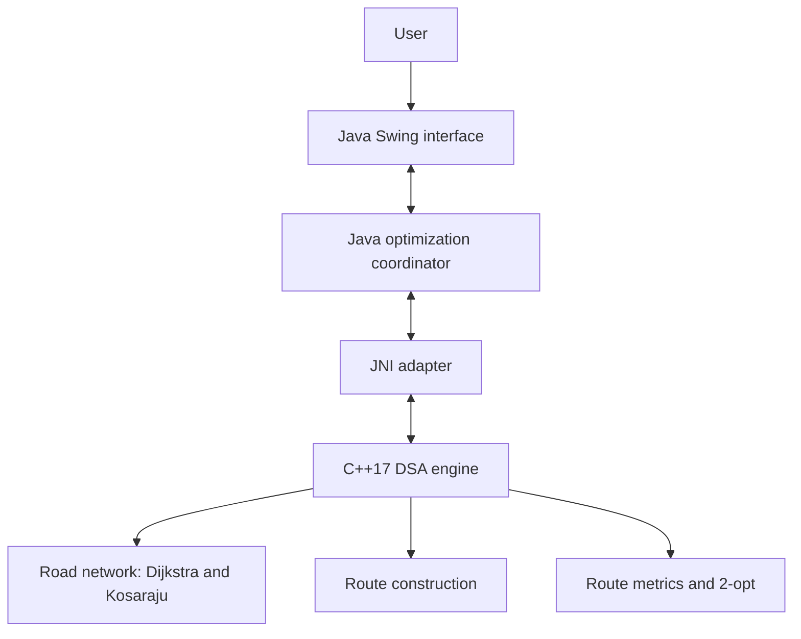

# RouteCraft — Multi-Depot Vehicle Routing Studio

**Team:** AlgoSmiths

**Course:** CSLR31 — Data Structures Laboratory

**Implementation:** Java, C++17, and JNI

RouteCraft is a desktop application for planning capacity-constrained delivery
routes from multiple depots. Users configure depots, customers, customer
demands, vehicle capacities, and depot-specific fleet availability. The
application builds and scores routes, improves stop order, and reports demand
that the configured real fleet cannot serve.

The project combines a Java Swing interface and planning coordinator with a
native C++ data-structures and algorithms engine. JNI connects the two layers.

## Contents

- [Features](#features)
- [Architecture](#architecture)
- [Planning workflow](#planning-workflow)
- [Algorithms and data structures](#algorithms-and-data-structures)
- [Fleet model](#fleet-model)
- [Technology stack](#technology-stack)
- [Repository structure](#repository-structure)
- [Build and run](#build-and-run)
- [Tests](#tests)
- [Using the application](#using-the-application)
- [Input and routing notes](#input-and-routing-notes)
- [Limitations](#limitations)
- [Team](#team)
- [OpenStreetMap attribution](#openstreetmap-attribution)

## Features

- Manage multiple depots and customer locations.
- Set customer demand and vehicle capacity.
- Configure dedicated and maximum ad-hoc vehicle counts separately for each
  depot.
- Build routes using Nearest Neighbor or Clarke–Wright Savings.
- Assign customers to depots using a capacity-aware heuristic and re-cluster
  customers when a depot cannot serve its assigned demand with its fleet.
- Run one bounded alternative-assignment pass and retain the lower-scoring
  complete plan.
- Improve route stop order with 2-opt local search.
- Load an OpenStreetMap (`.osm`) road extract and calculate road-network paths.
- Display dedicated, ad-hoc, and virtual planning routes separately.
- Simulate dispatch of feasible real-vehicle routes, export route data to CSV,
  and undo or redo supported editing operations.

## Architecture



| Layer | Main files | Responsibility |
|---|---|---|
| Presentation | `Source/Java/RouteCraftVRP.java` | Swing interface, map display, user input, OSM loading, route visualization, dispatch simulation, and export. |
| Java orchestration | `Source/Java/RouteOptimizerBridge.java` | Java data models, depot assignment, fleet planning, customer re-clustering, and calls to native routing functions. |
| JNI adapter | `Source/JNI/RouteOptimizerJni.cpp`, `include/JNI/RouteOptimizerJni.h` | Converts data between Java and C++, invokes the optimizer, and returns route and metric results. |
| Native DSA engine | `Source/DSA/`, `include/DSA/` | Road-graph algorithms, route construction, route scoring, local improvement, and shared native data structures. |

The Java interface sends routing work through the bridge and JNI to the native
C++ engine.

## Planning workflow

1. Load an optional OSM road extract. If no road graph is available, route legs
   use coordinate-based distance.
2. Assign customers to depots using distance and a depot-load penalty.
3. Build capacity-constrained routes for each depot using the selected
   construction heuristic.
4. Allocate dedicated vehicles first, then local ad-hoc vehicles. Try
   customer reassignment when a depot's real fleet cannot serve all its
   assigned demand.
5. Represent demand that the configured real fleet still cannot serve with
   virtual planning routes.
6. Test one bounded alternative customer assignment and keep the lower-scoring
   complete plan.
7. Apply 2-opt to improve route stop order, calculate final route metrics, and
   display the result. Dispatch is blocked while virtual routes remain.

This is a heuristic planning workflow, not an exact multi-depot vehicle
routing solver.

## Algorithms and data structures

The native DSA engine separates declarations in `include/DSA/` from
implementations in `Source/DSA/`. Its algorithms use custom containers in
`include/DSA/DsaContainers.h`; template definitions remain in the header.
Standard containers are used in the JNI adapter when converting Java data.

| Algorithm or structure | Location | Purpose |
|---|---|---|
| Dijkstra's shortest-path algorithm | `RoadNetworkAlgorithms.cpp` | Finds a minimum-objective path through the loaded directed, weighted road graph. |
| Kosaraju's strongly connected components algorithm | `RoadNetworkAlgorithms.cpp` | Finds strongly connected components; the implementation retains the largest component in the used road-node set. |
| Nearest Neighbor heuristic | `RouteConstructionAlgorithms.cpp` | Repeatedly adds the nearest remaining customer that fits the current route's capacity. |
| Clarke–Wright Savings heuristic | `RouteConstructionAlgorithms.cpp` | Greedily merges compatible route endpoints in descending savings order, subject to capacity. |
| 2-opt local search | `RouteImprovementAlgorithms.cpp` | Reverses route subsequences when doing so reduces the route score. |
| Capacity-aware depot assignment | `RouteOptimizerBridge.java` | Assigns customers using coordinate distance adjusted by depot load. |
| Customer re-clustering and bounded feedback | `RouteOptimizerBridge.java` | Tests feasible customer reassignment and retains the lower-objective complete plan. |
| Custom containers | `include/DSA/DsaContainers.h` | Implements the dynamic array, hash map, unique set, stack, and binary heap used by native DSA algorithms. |
| Adjacency lists | `RoadNode.edges` | Stores outgoing directed road edges for graph traversal and shortest-path search. |

### Directed road graph

The road network is a directed weighted graph. Two-way roads are represented
by edges in both directions, while one-way roads have an edge only in the
permitted direction. The OSM loader reads supported highway ways, estimates
segment distance from geographic coordinates, and derives travel-time and
cost estimates from available road tags and application defaults.

### Route objective

The native engine calculates distance, estimated travel time, and estimated
cost for each route leg. Its weighted score is:

```text
S = 0.40D + 0.35(T / 60 * 30) + 0.25(C / 12)
```

Here, `D` is distance in kilometres, `T` is time in minutes, and `C` is
estimated monetary cost. The score weights are configurable through the
bridge. The score is used for route construction, improvement, and comparison;
it is not a currency amount.

## Fleet model

Fleet inventory is configured independently for each depot.

| Fleet tier | Meaning | Dispatchable |
|---|---|---|
| Dedicated | Primary vehicles assigned to that depot. | Yes |
| Ad-hoc | Additional local vehicles activated up to that depot's configured maximum. | Yes |
| Virtual | Planning-only marker for demand the configured real fleet cannot cover. | No |

- Vehicles stay at their configured home depot; vehicles are not transferred
  between depots.
- Customer assignments can change when another depot can serve the customer
  with its own fleet.
- Each route starts and ends at its assigned depot.
- A customer whose individual demand exceeds vehicle capacity is rejected by
  the native optimizer.
- Dispatch is blocked while virtual routes remain.

## Technology stack

- **Java Swing:** desktop interface and map/route interaction.
- **Java:** application state, depot-level planning, and optimization
  orchestration.
- **C++17:** graph, route construction, route evaluation, and local-search
  algorithms.
- **JNI:** communication between Java and the native C++ library.
- **OpenStreetMap XML:** optional road-network input.
- **GNU Make:** native and Java build orchestration.
- **MinGW-w64 / `g++`:** Windows C++ compiler supported by the supplied
  scripts.
- **JDK:** Java compilation and runtime.

## Repository structure

```text
.
├── README.md
├── Makefile
├── run.bat
├── map.osm
├── Document/
│   ├── RouteCraft_Report.pdf
│   └── User_Manual.md
├── Source/
│   ├── DSA/
│   │   ├── README.md
│   │   ├── RoadNetworkAlgorithms.cpp
│   │   ├── RouteConstructionAlgorithms.cpp
│   │   ├── RouteCraftDsaTests.cpp
│   │   ├── RouteImprovementAlgorithms.cpp
│   │   └── RouteObjects.cpp
│   ├── Java/
│   │   ├── RouteCraftVRP.java
│   │   ├── RouteOptimizerBridge.java
│   │   └── RouteOptimizerBridgeTest.java
│   └── JNI/
│       └── RouteOptimizerJni.cpp
├── include/
│   ├── DSA/
│   │   ├── DsaContainers.h
│   │   ├── RoadNetworkAlgorithms.h
│   │   ├── RouteObjects.h
│   │   └── RouteOptimizer.h
│   └── JNI/
│       └── RouteOptimizerJni.h
└── Video/
    └── Video_routcraft.mp4
```

The `object/` and `build/` directories and the native test executable are
generated by the build and are not needed in the source tree.

## Build and run

### Requirements

On Windows, install:

1. JDK 17 or newer, with `javac` and `java` on `PATH`.
2. A 64-bit C++17 compiler. MinGW-w64 `g++` is supported; `run.bat` checks
   `C:\msys64\ucrt64\bin\g++.exe` before searching `PATH`.
3. `JAVA_HOME` set to the JDK installation directory, for example:

   ```bat
   set JAVA_HOME=C:\Program Files\Java\jdk-21
   ```

### Launch the desktop application on Windows

From the project root in Command Prompt:

```bat
run.bat
```

The script builds the C++ JNI library, compiles the Java application, and
launches the Swing interface.

### Build and test with GNU Make

With GNU Make, a compatible C++ compiler, and a configured JDK/JNI include
path:

```sh
make all
make test
```

`make test` builds the native test executable, native DLL, and Java classes,
then runs the native DSA tests and Java/JNI integration tests. To remove
generated build files:

```sh
make clean
```

The supplied `run.bat` is the simplest Windows launch path. The Makefile test
target requires a GNU Make-compatible environment.

## Tests

`Source/DSA/RouteCraftDsaTests.cpp` covers native algorithm behavior, including
route capacity and customer coverage, fleet tiers, strongly connected
component filtering, route metrics, graph behavior, and invalid input.

`Source/Java/RouteOptimizerBridgeTest.java` checks bridge-level behavior,
including fleet tiers across JNI, customer reassignment without moving
vehicles, capacity-aware assignment, and integration with native route
optimization.

Run both test suites with `make test` as described above.

## Using the application

1. Start RouteCraft with `run.bat`.
2. Add one or more depots and customer locations.
3. Enter each customer's demand.
4. Configure dedicated vehicles, vehicle capacity, and maximum local ad-hoc
   vehicles for each depot.
5. Optionally load an `.osm` file to use its road network.
6. Select Nearest Neighbor or Clarke–Wright Savings.
7. Select **Optimize Routes** and review the route list, vehicle loads, route
   metrics, and depot-wise fleet summary.
8. Dispatch only when the plan contains no virtual routes.
9. Export the route plan to CSV. Undo and redo are available for supported
   changes.

For detailed instructions, see the [user manual](Document/User_Manual.md).

## Input and routing notes

- The application can use the included `map.osm` or another supported OSM XML
  extract.
- Internet access is needed for online map tiles in the map view. It is not
  required for the native graph algorithms when a local OSM extract is loaded.
- Without a loaded road graph, the engine falls back to coordinate-based
  distance for route legs.
- The OSM loader filters supported highway ways and excludes ways tagged
  `access=no` or `motor_vehicle=no`.
- Segment speed uses `maxspeed` when available or a highway-type default.
  Segment cost is estimated by the application.

## Limitations

- Nearest Neighbor, Clarke–Wright Savings, greedy depot assignment, and 2-opt
  are heuristics; they do not guarantee a globally optimal solution.
- Initial depot assignment uses coordinate distance and a load penalty; it is
  not a global clustering optimizer.
- The feedback optimizer performs at most one alternative assignment pass.
- Estimated road times and costs are not live traffic data, actual fuel
  prices, or guaranteed operating costs.
- 2-opt improves stop order locally; it is not a multi-route or network-wide
  optimizer.
- Virtual vehicles indicate a fleet shortage and cannot be dispatched.

## Team

**AlgoSmiths**

- Meesala Hariteja — `106125071`
- Mayank Gupta — `106125069`
- Matta Jay Paul — `106125067`

## OpenStreetMap attribution

The project includes and/or can load OpenStreetMap road data. OpenStreetMap
data is available under the Open Database License (ODbL). When redistributing
OSM-derived data, retain the applicable attribution and comply with the ODbL.
See [OpenStreetMap Copyright and License](https://www.openstreetmap.org/copyright).
