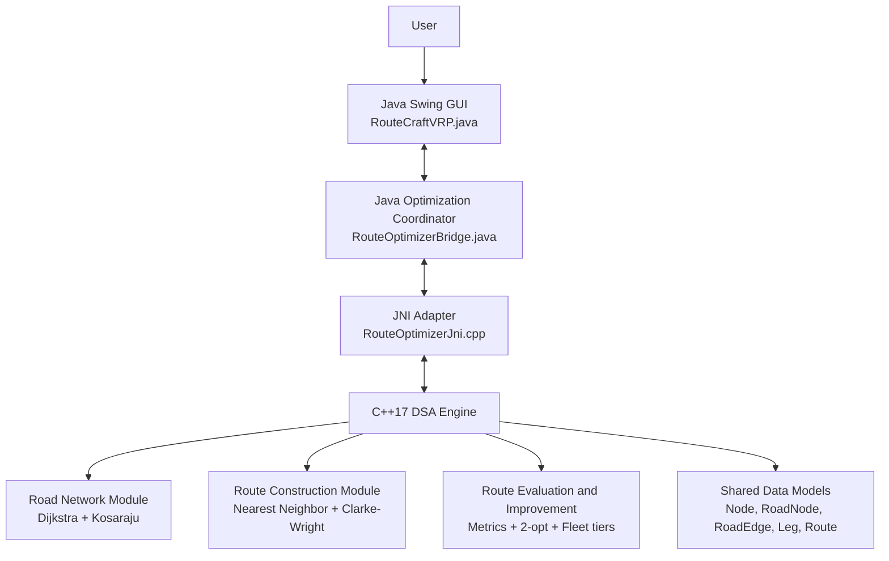

**# RouteCraft — Multi-Depot Vehicle Routing Studio**


**\*\*Team:\*\*** AlgoSmiths  

**\*\*Course:\*\*** CSLR31 — Data Structures Laboratory  

**\*\*Implementation:\*\*** Java, C++17 and JNI


RouteCraft is a desktop application for planning capacity-constrained delivery routes from multiple depots. The user defines depots, customers, customer demands and depot-wise vehicle availability. The application constructs routes using selectable heuristics, evaluates route metrics, improves stop order and reports any demand that the configured real fleet cannot serve.


The project combines a Java Swing interface and optimization coordinator with a native C++ data-structures and algorithms engine. JNI connects the two layers.


\---


**## Contents**


\- [Main capabilities]\(#main-capabilities)

\- [System architecture]\(#system-architecture)

\- [Optimization workflow]\(#optimization-workflow)

\- [Algorithms and data structures]\(#algorithms-and-data-structures)

\- [Fleet model]\(#fleet-model)

\- [Technology stack]\(#technology-stack)

\- [Repository structure]\(#repository-structure)

\- [Build and run]\(#build-and-run)

\- [Tests]\(#tests)

\- [Using the application]\(#using-the-application)

\- [Input and routing notes]\(#input-and-routing-notes)

\- [Current scope and limitations]\(#current-scope-and-limitations)

\- [Team]\(#team)


\---


**## Main capabilities**


\- Manage multiple depots and customer locations.

\- Set customer demand and vehicle capacity.

\- Configure dedicated and maximum ad-hoc vehicle counts separately for each depot.

\- Construct routes using **\*\*Nearest Neighbor\*\*** or **\*\*Clarke–Wright Savings\*\***.

\- Use a capacity-aware initial customer-to-depot assignment heuristic.

\- Re-cluster customers when a depot cannot serve its assigned demand with its available fleet.

\- Perform a bounded feedback pass that tests an alternative customer allocation and retains the lower-scoring complete plan.

\- Improve route stop order with **\*\*2-opt local search\*\***.

\- Load an OpenStreetMap (\`.osm\`) road extract and calculate road-network paths.

\- Display dedicated, ad-hoc and virtual planning routes separately.

\- Simulate dispatch of feasible real-vehicle routes, export route data to CSV, and use Undo/Redo for supported editing operations.


**## System architecture**


RouteCraft is divided into four cooperating layers.





**### Layer responsibilities**


\| Layer | Main files | Responsibility |

\|---|---|---|

\| Presentation | \`Source/Java/RouteCraftVRP.java\` | Swing interface, map display, user input, OSM loading, route visualization, dispatch simulation and export. |

\| Java orchestration | \`Source/Java/RouteOptimizerBridge.java\` | Java-side data models, depot assignment, fleet planning, customer re-clustering, feedback pass, and calls to native routing functions. |

\| JNI adapter | \`Source/JNI/RouteOptimizerJni.cpp\`, \`include/JNI/RouteOptimizerJni.h\` | Converts Java arrays and objects to native C++ data, invokes the optimizer, and returns route and metric results. |

\| Native DSA engine | \`Source/DSA/\`, \`include/DSA/\` | Graph algorithms, route construction, route scoring, local improvement and shared native data structures. |


The Java UI does not implement the native graph algorithms itself. It sends routing work through the bridge and JNI layer to the C++ engine.


**## Optimization workflow**


The high-level planning process is:

```mermaid
flowchart TD
    A([Start]) --> B["Enter planning data<br/>Depots · Customers · Demand · Fleet"]
    B --> C["Load road network<br/>OpenStreetMap .osm (optional)"]

    C --> D{"Road network available?"}
    D -->|Yes| E["Build directed, weighted road graph<br/>Junctions = nodes · Roads = edges"]
    D -->|No| F["Use coordinate-based distance<br/>for route-leg estimates"]
    E --> G["Prepare road graph"]
    G --> H["Kosaraju: identify strongly connected components"]
    H --> I["Retain the largest SCC<br/>Remove nodes outside it"]
    I --> J["Dijkstra: calculate shortest road paths"]
    F --> K["Road-distance preparation complete"]
    J --> K

    K --> L["Assign customers to depots<br/>Distance + depot-load penalty"]
    L --> M["Form one customer cluster per depot"]
    M --> N["Construct depot routes<br/>Nearest Neighbor OR Clarke–Wright Savings"]
    N --> O["Check route capacity and depot fleet"]
    O --> P["Allocate dedicated vehicles first"]
    P --> Q["Activate local ad-hoc vehicles if needed"]
    Q --> R["Represent remaining uncovered demand<br/>with virtual planning routes"]

    R --> S["Try reassignment to another depot<br/>with available local fleet"]
    S --> T["Rebuild affected depot plans"]
    T --> U["First complete planning solution"]

    U --> V["Select customers on ad-hoc / virtual routes"]
    V --> W{"Alternative depot assignment available?"}
    W -->|No| X["Keep first solution"]
    W -->|Yes| Y["Run one bounded feedback pass"]
    Y --> Z["Compare complete solutions<br/>Route score + ad-hoc penalty + virtual-demand penalty"]
    Z --> AA{"Second solution has lower objective?"}
    AA -->|Yes| AB["Keep second solution"]
    AA -->|No| X

    X --> AC["Apply 2-opt to improve stop order"]
    AB --> AC
    AC --> AD["Calculate final distance, time, cost<br/>and fleet summary"]
    AD --> AE["Display routes on the map<br/>Dedicated · Ad-hoc · Virtual"]
    AE --> AF{"Any virtual routes remaining?"}
    AF -->|Yes| AG["Show fleet shortage<br/>Dispatch is blocked"]
    AF -->|No| AH["Dispatch feasible real-vehicle routes"]
    AG --> AI([End])
    AH --> AI

    classDef input fill:#e8f1ff,stroke:#3973ac,color:#102a43;
    classDef process fill:#eef7ee,stroke:#4b8b52,color:#183b1a;
    classDef decision fill:#fff4d6,stroke:#bd8b24,color:#503b0b;
    classDef output fill:#f0eaff,stroke:#8061b3,color:#30204d;
    class B,C input;
    class E,F,G,H,I,J,K,L,M,N,O,P,Q,R,S,T,U,V,Y,Z,AB,AC,AD process;
    class D,W,AA,AF decision;
    class AE,AG,AH output;
```





**How to read the flowchart:** RouteCraft first prepares the road network, then assigns customers to depots and builds a separate set of routes for each depot. It checks whether the depot's own vehicles can serve those customers. If not, it tries local ad-hoc vehicles and customer reassignment; any demand still uncovered is shown as a virtual route. The coordinator then tests one bounded alternative assignment and keeps the better complete plan. Finally, 2-opt improves the stop order, the application calculates route metrics, and the map displays the result. Virtual routes indicate a fleet shortage and cannot be dispatched.


**### 1. Capacity-aware initial assignment**


Customers are initially assigned to depots using a distance-based cost adjusted by the current assigned-demand utilization of each depot. This creates the initial customer clusters, with each cluster associated with one depot:


\\[

C(i,j)=d(i,j)\left(1+\alpha\frac{D_j}{K_j}\right)

\\]


where:


\- \\(d(i,j)\\) is the coordinate distance from customer \\(i\\) to depot \\(j\\).

\- \\(D_j\\) is the demand already assigned to depot \\(j\\).

\- \\(K_j\\) is the configured dedicated-plus-maximum-ad-hoc capacity of depot \\(j\\).

\- \\(\alpha\\) is the load penalty factor (currently \`0.5\`).


This discourages overloading a geographically close depot when another depot has more spare capacity. It is a heuristic assignment cost, not a guarantee of globally optimal clusters. A depot with no configured fleet is strongly penalized during initial assignment.


**### 2. Route construction**


For each depot's customer cluster, the selected construction method creates capacity-constrained closed routes that start and end at that depot:


\- **\*\*Nearest Neighbor:\*\*** repeatedly selects the nearest remaining customer that fits in the current vehicle's remaining capacity. When no further customer fits, it closes that route and starts another.

\- **\*\*Clarke–Wright Savings:\*\*** starts with one route per customer, computes pairwise savings, sorts candidate savings in descending order and merges routes when endpoint and capacity conditions permit.


**### 3. Fleet allocation and customer re-clustering**


The Java coordinator evaluates depot-specific plans. Customers may be reassigned to another depot if that depot can accommodate the customer with its own configured fleet. The receiving depot's route plan is recalculated when a customer moves.


The planning stages prioritize dedicated vehicles, then local ad-hoc vehicles. Virtual routes represent remaining planned demand that cannot be assigned to the configured real fleet. A further reassignment attempt considers remaining real fleet capacity at other depots.


**\*\*Vehicles never move between depots.\*\*** Only customer assignments change. Every route remains associated with its home depot and starts and ends there.


**### 4. Bounded feedback pass**


After the first complete plan, the coordinator selects customers on ad-hoc or virtual routes as candidates for alternative depot assignment. Virtual-route customers receive higher priority; distance from the current depot is also used to order candidates. A bounded subset is tested at other depots subject to the receiving depot's configured capacity.


If at least one assignment changes, RouteCraft runs the complete depot pipeline once more. It compares the two plans using a common objective containing route score, an ad-hoc route penalty and a much larger virtual-demand penalty. The lower-objective plan is retained.


This is a **\*\*two-pass heuristic\*\***, not an exact MDVRP solver. It evaluates one feedback alternative; it does not exhaustively search all possible customer assignments.


**### 5. Route improvement and output**


The C++ engine applies 2-opt to constructed routes. Route metrics are then available to the application for display and comparison. The UI distinguishes real fleet routes from virtual planning routes. Dispatch is blocked while virtual routes remain in the plan.


**## Algorithms and data structures**


The native DSA engine separates declarations in \`include/DSA/\` from

implementations in \`Source/DSA/\`, as required by the assignment. Its algorithms

use custom containers in \`include/DSA/DsaContainers.h\` rather than STL

containers or algorithms; the JNI adapter retains standard containers only

while converting Java arrays. Template container definitions remain in their

header so they are available at instantiation.


\| Algorithm / structure | Where it is used | Purpose |

\|---|---|---|

\| **\*\*Dijkstra's shortest-path algorithm\*\*** | \`RoadNetworkAlgorithms.cpp\` | Finds a minimum-objective path through the loaded directed, weighted road graph. A custom binary heap selects the next unsettled vertex. |

\| **\*\*Kosaraju's SCC algorithm\*\*** | \`RoadNetworkAlgorithms.cpp\` | Finds strongly connected components using a finishing-order DFS followed by a DFS over the reversed graph. The implementation retains the largest SCC in the used road-node set. |

\| **\*\*Nearest Neighbor heuristic\*\*** | \`RouteConstructionAlgorithms.cpp\` | Builds a route by repeatedly choosing the nearest remaining customer that satisfies vehicle capacity. |

\| **\*\*Clarke–Wright Savings heuristic\*\*** | \`RouteConstructionAlgorithms.cpp\` | Computes savings for customer pairs and greedily merges compatible route endpoints while respecting capacity. |

\| **\*\*2-opt local search\*\*** | \`RouteImprovementAlgorithms.cpp\` | Reverses route subsequences when the replacement edges reduce the route's weighted score. The implementation stops when no improvement is found or the iteration limit is reached. |

\| **\*\*Capacity-aware greedy assignment\*\*** | \`RouteOptimizerBridge.java\` | Assigns customers to depots using coordinate distance multiplied by a depot-load factor. |

\| **\*\*Greedy customer re-clustering\*\*** | \`RouteOptimizerBridge.java\` | Attempts to move customers from a depot's virtual routes to another depot whose own fleet can serve the resulting cluster. |

\| **\*\*Bounded two-pass feedback heuristic\*\*** | \`RouteOptimizerBridge.java\` | Generates one alternative assignment pass and retains the lower-objective complete plan. |

\| **\*\*Custom containers\*\*** | \`include/DSA/DsaContainers.h\` | Implements the dynamic array, hash map, unique set, stack, and binary heap used by native DSA algorithms. |

\| **\*\*Adjacency lists\*\*** | \`RoadNode.edges\` | Stores outgoing directed road edges for graph traversal and shortest-path search. |

\| **\*\*Hash maps\*\*** | C++ and Java modules | Provide lookup for road nodes, cached route legs, node ownership and grouped customer data. |

\| **\*\*Stacks\*\*** | \`RoadNetworkAlgorithms.cpp\` | Support iterative depth-first traversal and finishing-order processing in Kosaraju's algorithm. |


**### Directed road graph and road direction**


The road network is stored as a **\*\*directed weighted graph\*\***. This does not mean every road is one-way:


\- A two-way road is represented by two directed edges, one in each direction.

\- A one-way road is represented by an edge only in its permitted direction.

\- A reverse-only OSM way (\`oneway=-1\`) is represented in the reverse direction.


The OSM loader reads supported highway ways, estimates segment distance from geographic coordinates, derives travel-time estimates from a default or tagged speed, and estimates segment cost. Dijkstra operates on the directed outgoing edges.


**### Route objective and metrics**


The native engine calculates distance, estimated travel time and estimated cost for each route leg. Its weighted score is:


\\[

S=0.40D+0.35\left(\frac{T}{60}\times30\right)+0.25\left(\frac{C}{12}\right)

\\]


where \\(D\\) is kilometres, \\(T\\) is minutes and \\(C\\) is the estimated monetary cost. The weights are configurable through the bridge. The route score is used by construction/improvement and route comparison; it should not be interpreted as a real currency amount.


**## Fleet model**


Fleet inventory is configured independently for each depot.


\| Fleet tier | Meaning | Dispatchable? |

\|---|---|---|

\| **\*\*Dedicated\*\*** | Primary vehicles assigned to that depot. | Yes |

\| **\*\*Ad-hoc\*\*** | Additional local vehicles activated up to that depot's configured maximum. | Yes, as real planned vehicles. |

\| **\*\*Virtual\*\*** | Planning-only route marker for demand that the configured real fleet cannot cover. | **\*\*No\*\*** |


Important rules:


\- Dedicated and ad-hoc vehicles stay at their configured home depot.

\- RouteCraft does not borrow or transfer vehicles between depots.

\- Customer assignments can change between depots when the receiving depot can serve the customer with its own fleet.

\- Each route starts and ends at its assigned depot.

\- A customer whose individual demand exceeds vehicle capacity is rejected by the native optimizer.

\- Dispatch is blocked if virtual routes remain.


**## Technology stack**


\- **\*\*Java Swing:\*\*** desktop interface and map/route interaction.

\- **\*\*Java:\*\*** application state, depot-level planning and optimization orchestration.

\- **\*\*C++17:\*\*** graph, route construction, route evaluation and local-search algorithms.

\- **\*\*JNI:\*\*** communication between Java and the native C++ library.

\- **\*\*OpenStreetMap XML:\*\*** optional road-network input.

\- **\*\*Make:\*\*** native and Java build orchestration.

\- **\*\*MinGW-w64 / g++:\*\*** Windows C++ compiler supported by the supplied scripts.

\- **\*\*JDK:\*\*** Java compilation and runtime.


**## Repository structure**


```text

Algosmiths_106125071_106125069_106125067_Project/

│

├── README.md                         # Project overview and technical guide

├── Makefile                          # Build and test targets

├── run.bat                           # Windows build-and-launch script

├── map.osm                           # Included OpenStreetMap road extract

├── .gitignore

│

├── Document/

│   ├── User_Manual.md                # End-user instructions

│   └── DSA_Guide.md                  # DSA design and implementation overview

│

├── Source/

│   ├── Java/

│   │   ├── RouteCraftVRP.java        # Swing GUI, OSM loading and interaction

│   │   ├── RouteOptimizerBridge.java # Java planning and JNI bridge

│   │   └── RouteOptimizerBridgeTest.java # Java/JNI integration tests

│   │

│   ├── JNI/

│   │   └── RouteOptimizerJni.cpp     # JNI implementation / data conversion

│   │

│   └── DSA/

│       ├── RouteObjects.cpp

│       ├── RouteConstructionAlgorithms.cpp

│       ├── RouteImprovementAlgorithms.cpp

│       ├── RoadNetworkAlgorithms.cpp

│       └── RouteCraftDsaTests.cpp     # Native DSA tests

│

├── include/

│   ├── DSA/

│   │   ├── DsaContainers.h

│   │   ├── RouteObjects.h

│   │   ├── RouteOptimizer.h

│   │   └── RoadNetworkAlgorithms.h

│   └── JNI/

│       └── RouteOptimizerJni.h

│

├── object/                           # Compiled C++ object files (generated)

├── build/                            # Java classes and native DLL (generated)

└── a.out                              # Native test executable (generated)

```


\`object/\`, \`build/\` and \`a.out\` contain generated build products. They can be recreated using the build commands below.


**## Build and run**


**### Requirements (Windows)**


1\. **\*\*JDK 17 or newer\*\*** — \`javac\` and \`java\` must be available on \`PATH\`.

2\. **\*\*64-bit C++17 compiler\*\*** — MinGW-w64 \`g++\` is supported. The supplied \`run.bat\` checks \`C:\msys64\ucrt64\bin\g++.exe\` first, then searches \`PATH\`.

3\. **\*\*\`JAVA_HOME\`\*\*** — set it to the JDK installation directory, for example:


   ```bat

   set JAVA_HOME=C:\Program Files\Java\jdk-21

   ```


**### Launch the desktop application**


From the project root in Command Prompt:


```bat

run.bat

```


The script compiles the C++ JNI library, compiles the Java application and launches the Swing interface.


**### Build and run tests with Make**


If GNU Make and a compatible C++ compiler are installed:


```bash

make all

make test

```


\`make test\` builds the native test executable, native DLL and Java classes, then runs:


\- \`a.out\` — native C++ DSA test suite.

\- \`RouteOptimizerBridgeTest\` — Java/JNI integration tests.


To remove generated build files:


```bash

make clean

```


\> The supplied \`run.bat\` is the simplest Windows launch path. The Makefile test target is intended for an environment with GNU Make, a compatible compiler and a correctly configured JDK/JNI include path.


**## Tests**


**### Native DSA tests**


\`Source/DSA/RouteCraftDsaTests.cpp\` covers the native algorithm layer, including:


\- route capacity and customer coverage for both construction methods;

\- dedicated, ad-hoc and virtual fleet-tier behavior;

\- strongly connected component filtering;

\- route metrics and graph behavior;

\- invalid input handling.


**### Java/JNI integration tests**


\`Source/Java/RouteOptimizerBridgeTest.java\` checks bridge-level behavior, including:


\- preservation of fleet tiers across JNI;

\- customer reassignment without moving physical vehicles;

\- capacity-aware initial assignment behavior;

\- integration of Java planning with native route optimization.


Run the complete available test targets using \`make test\` as described above.


**## Using the application**


1\. Start RouteCraft using \`run.bat\`.

2\. Add one or more depots and customer locations in the interface.

3\. Enter each customer's demand.

4\. Configure dedicated vehicles, vehicle capacity and maximum local ad-hoc vehicles for each depot.

5\. Optionally load an \`.osm\` file to use its road network.

6\. Select **\*\*Nearest Neighbor\*\*** or **\*\*Clarke–Wright Savings\*\***.

7\. Select **\*\*OPTIMIZE ROUTES\*\*** and review the route list, vehicle loads, route metrics and depot-wise fleet summary.

8\. Dispatch only when the plan contains no virtual routes. Use the dispatch controls to pause or adjust the simulation.

9\. Use **\*\*EXPORT CSV\*\*** to export the route plan. Undo/Redo are available for supported changes.


For detailed end-user instructions, see [\`Document/User_Manual.md\`]\(Document/User_Manual.md).


**## Input and routing notes**


\- The application can use the included \`map.osm\` or another supported OSM XML extract.

\- Internet access is needed for online map tiles in the map view; it is not a requirement for the native graph algorithms when a local OSM extract is loaded.

\- When no road graph is loaded, the engine falls back to straight-line coordinate distance for route legs.

\- The OSM loader filters for supported highway ways and excludes ways tagged with \`access=no\` or \`motor_vehicle=no\`.

\- Segment speed is estimated from \`maxspeed\` when available or from a highway-type default. Segment cost is estimated by the application.


**## Current scope and limitations**


\- Nearest Neighbor, Clarke–Wright Savings, greedy depot assignment and 2-opt are heuristics. They do not guarantee a globally optimal multi-depot vehicle-routing solution.

\- The capacity-aware initial assignment uses coordinate distance and a load penalty; it is not a global clustering optimizer.

\- The feedback optimizer performs at most one alternative pass. It does not explore every possible customer-to-depot allocation.

\- The current road weights and estimated segment times/costs are model estimates, not live traffic, actual fuel prices or guaranteed operating costs.

\- The route-improvement 2-opt method reverses stop subsequences based on the route score. It is a local improvement step, not a complete multi-route or network-wide optimizer.

\- Virtual vehicles are shortage indicators only; they cannot be dispatched.


**## Team**


**\*\*AlgoSmiths\*\***


\- Meesala Hariteja — \`106125071\`

\- Mayank Gupta — \`106125069\`

\- Matta Jay Paul — \`106125067\`


\---


**## OpenStreetMap attribution**


The project includes and/or can load OpenStreetMap road data. OpenStreetMap data is available under the Open Database License (ODbL). When redistributing OSM-derived data, retain the applicable attribution and comply with the ODbL. See [OpenStreetMap Copyright and License]\(https\://www\.openstreetmap.org/copyright).
